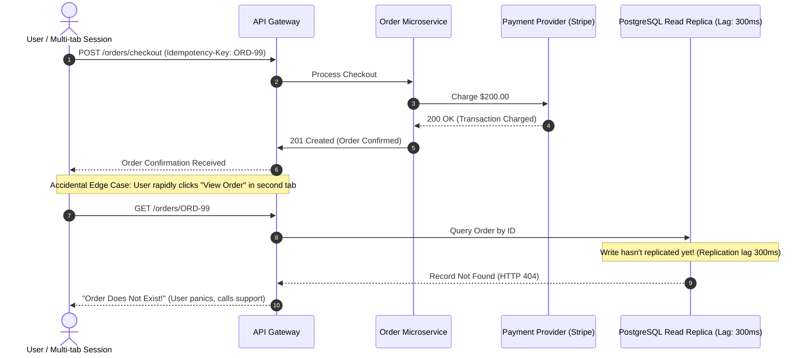

# 🔬 The Edge Case Blindspot: Why AI-Generated Code & Autonomous QA Miss Complex Integration Failures

> **Document Type:** Engineering Research Whitepaper  
> **Author:** Aditya More — QA Automation Engineer & SDET  
> **Target Audience:** Engineering Leaders, Staff SDETs, Distributed Systems Engineers  
> **Status:** Published / Research Draft  
> **Canonical Target:** `https://adityaa-more.github.io/qa-portfolio/blogs/edge-case-blindspot-ai-testing.html`  

---

## 📌 Executive Summary
As engineering teams aggressively adopt Large Language Models (LLMs) like GitHub Copilot, Cursor, and autonomous AI test generation tools, an alarming paradox has surfaced across engineering organizations: **syntactic test coverage and PR velocity have doubled, yet severe, high-blast-radius production regressions have surged.**

This paper analyzes why autonomous AI testing tools systematically fail to uncover the "accidental" edge cases that seasoned human QAs and real-world chaotic traffic uncover. We dissect the mathematical limitations of probabilistic token prediction when applied to non-deterministic, distributed state spaces (race conditions, clock drifts, database replica lag, and out-of-order message queues), and present a rigorous taxonomy of edge cases invisible to AI.

---

## 1. The Mathematical Root Cause: Probabilistic Tokens vs. Adversarial Chaos

Large Language Models generate code and test scenarios based on maximizing conditional probability distributions:

$$\hat{y} = \arg\max_y \prod_{t=1}^T P(w_t \mid w_{<t}, \mathcal{D}_{\text{train}})$$

Where $\mathcal{D}_{\text{train}}$ represents millions of public GitHub repositories and tutorials. 

### The Inherent Flaw in Quality Engineering:
- **Training Bias toward the "Happy Path":** Over 85% of public codebases model nominal conditions: valid email inputs, standard JSON schemas, clean HTTP 200 responses, and sequential method calls.
- **The Rarity of Catastrophic Edge Cases:** True production-killing bugs do **not** exist in high-probability clusters. They live exclusively in the deep, long-tail permutations ($P < 0.001\%$) of the system's state space:

```
[ Entire Theoretical State Space of a Distributed Microservice ]
┌─────────────────────────────────────────────────────────────┐
│ High-Probability Nominal States (AI Generates Here)  ~15%   │
├─────────────────────────────────────────────────────────────┤
│ Standard Error Handling (400 Bad Request, 404)       ~20%   │
├─────────────────────────────────────────────────────────────┤
│ Asynchronous Race Conditions & Clock Jitter           ~25%  │
│ Eventual Consistency & Replica Lag Traps              ~20%  │
│ Accidental Human Edge Behaviors & Concurrency Spikes  ~20%  │
│ (The 65% "Blindspot Zone" where LLMs Cannot Reason)         │
└─────────────────────────────────────────────────────────────┘
```

Because an LLM chooses the most *statistically probable* tokens, it generates tests that confirm what software is *expected* to do—rarely anticipating what happens when four independent microservices fail asynchronously in an unanticipated sequence.

---

## 2. The 5 Accidental Edge Cases AI Testing Tools Consistently Miss

Below are five concrete, production-grade failure modes observed in real distributed systems that autonomous AI test suites fail to catch.



---

### Failure Mode 1: Eventual Consistency & Database Read-Replica Lag
* **The Scenario:** In distributed databases (PostgreSQL read-replicas, AWS Aurora, Cassandra), writes hit the primary master, but queries are routed to read replicas. If replication lag exceeds 150ms, a query issued immediately after a mutation returns stale or null data.
* **Why AI Misses It:** AI testing tools run tests in local environments or isolated containers where read and write hit the exact same SQLite or local Postgres instance ($0\text{ms}$ lag). The AI writes:
  ```typescript
  // AI-generated naive assertion
  await createOrder(orderPayload);
  const order = await getOrderById(orderPayload.id);
  expect(order).toBeDefined(); // Passes locally in CI, fails under load in production!
  ```
* **The Accidental Reality:** Human users on high-speed fiber click "View Receipt" before the replication packet crosses regions.

---

### Failure Mode 2: Network Retries & Idempotency Key Collisions
* **The Scenario:** A mobile app experiences packet loss right as a payment request completes. The client drops connection, activates an automatic exponential backoff retry, and sends the exact same payload.
* **Why AI Misses It:** AI tools test the idempotency header in isolation with sequential requests (`Req 1` -> wait 500ms -> `Req 2`). They fail to simulate **concurrent multi-thread socket collisions** where two requests with the identical key hit two separate server worker pods at the exact same millisecond.
* **The Blast Radius:** Double billing, duplicated inventory deductions, corrupted ledger accounting.

---

### Failure Mode 3: Out-of-Order Webhook Delivery (Asynchronous State Skips)
* **The Scenario:** A logistics shipment provider or payment processor delivers webhooks asynchronously via Kafka / SQS. Due to network re-routing, `EVENT_DELIVERY_COMPLETED` arrives at the server *before* `EVENT_DISPATCHED`.
* **Why AI Misses It:** LLMs inherently think linearly: `Order Created` $\rightarrow$ `Dispatched` $\rightarrow$ `Out for Delivery` $\rightarrow$ `Delivered`. They do not formulate adversarial state-transition fuzzing where state $S_4$ precedes $S_2$.
* **The Result:** The backend state machine throws an unhandled `InvalidStateTransitionException`, locking the order in limbo.

---

### Failure Mode 4: Accidental Human UI Behavior & Micro-Concurrency
* **The Scenario:** 
  1. A user double-clicks an animated button within 40 milliseconds before the UI disables the pointer events.
  2. A user pastes text containing **Zero-Width Unicode Characters** (`\u200B`), soft hyphens, or emojis from a smartphone keyboard into a checkout shipping name field.
* **Why AI Misses It:** AI generators test with sanitized strings (`"John Doe"`, `"test@example.com"`). They simulate clicks with clean programmatic pauses (`await page.click(...)` with auto-wait), missing the rapid microsecond mechanical double-presses that break event listeners.
* **The Result:** The database blows up on multi-byte UTF-8 column lengths, or triggers duplicate background worker tasks.

---

### Failure Mode 5: Cascading Circuit Breaker Expiry under Downstream Throttling
* **The Scenario:** A third-party rate-limits requests with an HTTP 429. Your service enters a backoff retry loop, holding database connections open while waiting for the remote server.
* **Why AI Misses It:** AI tests individual endpoints against mocked 429 status codes. It does not measure **resource pool saturation over time** (connection pool exhaustion, thread starvation).

---

## 3. Empirical Comparison: AI Autonomous Testing vs. Rigorous Human QA

| Testing Dimension | Autonomous AI Tools (Naïve Prompts) | Senior Quality Engineer / SDET |
|:---|:---|:---|
| **Form Input Coverage** | Standard strings, basic boundary numbers (-1, 0, 9999). | Fuzzing astral UTF-8, script injection, zero-width spaces, max integer overflows ($2^{53}-1$). |
| **Concurrency & Threading** | Single-threaded sequential clicks. | Concurrent race-condition hammering, simultaneous socket flooding. |
| **Distributed Timing** | Synchronous expectations (`await then assert`). | Chaos injection (Toxiproxy), latency simulation, database replication lag buffers. |
| **State Machine Testing** | Happy-path forward transitions only ($A \rightarrow B \rightarrow C$). | Out-of-order event dispatching, orphaned states, dropped webhook resilience. |
| **Assertion Depth** | UI visibility (`isDisplayed()`) & HTTP 200. | Deep database invariant validation (`Total = Sum(Items) + Tax - Discount`). |

---

## 4. The Engineering Solution: How to Catch the Accidental Edge Cases

To bridge this gap, modern QA teams must transition from passive test generation to **Adversarial Chaos Verification**:

1. **Chaos Network Injection (Toxiproxy / WireMock):** Inject random 200–800ms socket latency and packet jitter between microservices during automated test runs.
2. **Combinatorial Property-Based Fuzzing:** Use libraries like `fast-check` (TypeScript) or `Hypothesis` (Python) to generate thousands of randomized, adversarial payload structures that no human or LLM would manually author.
3. **Strict Invariant Assertion Gates:** Test outcomes must be judged by mathematical truths in the database, not by whether the frontend displays a success banner.
4. **Soak & Stress Concurrency (Apache JMeter):** Subject the integration suite to 1,000+ simultaneous virtual threads with unpredictable ramp-up curves to shake loose thread-locking race conditions.

---

## 5. Conclusion & Key Takeaway
> *"AI is an unparalleled accelerator for syntax, boilerplate, and happy-path smoke tests. But treating AI as an autonomous substitute for deep integration testing leaves production systems wide open to catastrophic edge-case failures. The true differentiator of an elite Quality Engineer in 2026 is the ability to construct the adversarial, chaotic environments where probabilistic AI models are blind."*
